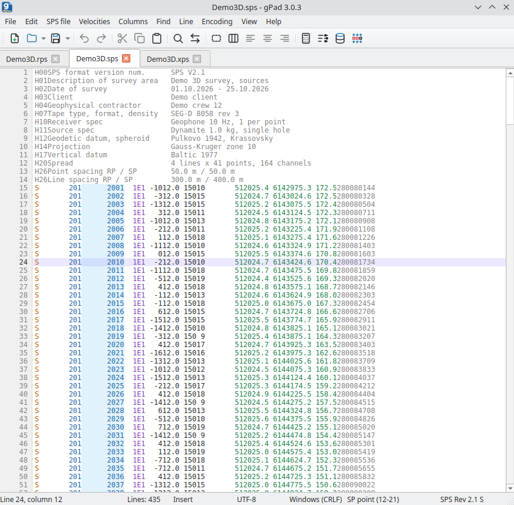

# gPad

**A text editor for geophysicists**

gPad works with any text files, but is built first of all for seismic data: SPS
acquisition geometry (R, S and X), velocity functions (VELF, LVI, Handvel, V5, etc.), static
corrections and coordinates. Fields in such files are tied to fixed positions, so the editor
has block selection and column mode: any operation or edit applies to the whole column at
once, not line by line.

The program detects the SPS revision and record kind by itself, highlights the fields and
offers only the operations that fit. Points from all open files are shown on a map with shots
and the active spread, and coordinates, elevations and statics can be collected in the SP and
RP database to fill SPS files with them later.



## Download

[:material-microsoft-windows: Windows](https://github.com/daniscoder/daniscoder.github.io/releases/download/gPad/gpad-setup.exe){ .md-button .md-button--primary }
[:material-linux: Linux](https://github.com/daniscoder/daniscoder.github.io/releases/download/gPad/gpad.tar.xz){ .md-button }
[:material-linux: Linux (older systems)](https://github.com/daniscoder/daniscoder.github.io/releases/download/gPad/gpad-legacy.tar.xz){ .md-button }

The current version is 3.0.5. For Windows there is an installer: by default it installs
the program for you only, without administrator rights, with a shortcut in the Start menu
(on the desktop - optionally); for all users - by a choice in the first window. The
program checks for updates itself and installs a new version with one button.

For Linux there is an archive: unpack it and run `install.sh`, and the program appears in
the applications menu and as the `gpad` command; no administrator rights are needed. To
remove it, run `uninstall.sh` in the program folder `~/.local/share/gpad`. The Linux
version is meant for systems with glibc 2.38 or newer: Ubuntu 24.04 and newer, Debian 13,
Fedora 39 and newer, RHEL, Rocky and Alma 10 ([more](index.md#run)). Like on Windows, it
installs a new version itself with one button.

For older systems - CentOS 7, RHEL, Rocky and Alma 8 and 9, Ubuntu 22.04, Debian 12, Astra
Linux - there is the "Linux (older systems)" build: it is built with Qt5 and runs on any
system with glibc 2.17 or newer. It is installed the same way, from the `gpad-legacy.tar.xz`
archive, and updates itself too. It has no choice of theme: windows always follow the
system theme.

```bash
tar -xJf gpad.tar.xz
./gpad/install.sh
```

To try the editor, you can download a sample 3D survey in SPS Rev 2.1 -
[Demo3D.rps](examples/gpad/Demo3D.rps), [Demo3D.sps](examples/gpad/Demo3D.sps) and
[Demo3D.xps](examples/gpad/Demo3D.xps); the screenshot above is made from it.

### Version 2.0 for Windows older than 10

For Windows older than 10, where 3.0 does not run, the previous version 2.0 stays on the
site. No installation is needed: the program is a single file. Version 2.0 is no longer
developed, and it lacks what appeared in 3.0. Its interface is in Russian only.

[:material-microsoft-windows: Windows (2.0)](https://github.com/daniscoder/daniscoder.github.io/releases/download/gPad/gPad.exe){ .md-button }

## Plain text

For plain text the editor offers the standard set of features:

- several files in tabs, recent files, appending another file to the end of a page,
  splitting a large file into parts;
- at startup the previous files open at the same place in the text; a file changed by
  another program is reloaded by itself, and with unsaved edits the program asks first;
- files of millions of lines open in the background in seconds and edit without delays;
- the UTF-8, UTF-16, Windows-1251, DOS-866, KOI8-R and Windows-1252 encodings and
  Windows, Unix and Mac line endings are detected on opening, and the file is saved in
  them;
- find and replace, including regular expressions and within a selection; search in all
  pages at once with a list of the results;
- bookmarks: ten numbered ones and free ones; all lines with a bookmark or, the other way
  round, without one can be deleted;
- a changed-lines bar next to the line numbers: yellow - changed and not saved, green -
  saved;
- sorting lines, including sorting by columns with any number of levels;
- removing empty lines, duplicates and lines by a mask, keeping every N-th line,
  changing case;
- text cleanup: replacing characters (for example, a decimal comma with a dot), Cyrillic
  look-alike letters to Latin in point codes, invisible characters, trailing spaces,
  tabs;
- table highlighting: in text in columns (exports of coordinates, statics, elevations) the
  header, integers, decimals and text get different colors, a non-number in a numeric column
  and a line with a different number of columns are underlined, and the column under the
  cursor is highlighted in all lines, with its name in the status bar;
- code and settings file highlighting by extension: processing scripts (Python, shell,
  PowerShell, bat, awk, Perl, MATLAB, Fortran and others), JSON, YAML, TOML, INI, XML, Markdown,
  Makefile, .gitignore, diffs - almost forty languages and formats.

Each kind of highlighting - tables, code, SPS and velocities - can be turned off in "View" -
"Highlighting".

Windows follow the system theme or one of the themes: light, dark, gray, warm or high contrast.
Text colors are chosen separately in "View" - "Text colors": the windows can be light while the
text is on a dark background.

## Columns

Block selection and column mode extend the standard features of the editor when working
with column formats. A block is selected with the mouse with Alt or with Alt and the
arrow keys. The following operations are available for a column:

- typing text from the keyboard right into a column: what you type, Backspace and Delete
  act on all lines of the column below the cursor at once, at the same position;
- inserting, deleting, cutting and shifting a column; aligning it left, right or center;
- inserting numbering with a given first number, step and leading zeros;
- column arithmetic (add, subtract, multiply, divide, set a value) and a summary: number
  of values, minimum, maximum, sum and mean;
- inserting a column from the clipboard, including repeating it to the end of the text,
  and laying out delimited text in even columns.

## SPS

The program understands SPS R, S and X of the Rev 0 and Rev 2.1 revisions. It detects
the record kind and revision from the beginning of the file, and the "SPS file" menu
offers only the items that fit the page. For SPS files there are:

- field highlighting by meaning: key, index and code, coordinates and elevation, date and
  time; asterisks and non-numbers in numeric fields are marked as errors. The field under
  the cursor is highlighted in all records, and its name and positions are shown in the
  status bar;
- the "SPS formats" window with the field positions of R, S and X in Rev 0 and Rev 2.1. It does
  not get in the way of editing, and the row of the field under the cursor is selected in it by
  itself;
- conversion between Rev 0 and Rev 2.1 and bringing records to the standard. A value that
  does not fit into a field is written as asterisks, and the program reports it: nothing
  is cut off silently;
- selecting, clearing and arithmetic on SPS columns by field names, selecting records by
  the values of a field;
- sorting, including by SPS fields with any number of levels, finding the current shot
  point in S and X files, removing duplicate points;
- working with the header and records: remove comments, insert extra information -
  index, code, Julian day, time;
- checking X: unify record numbers, show missing ones, remove reshoots of shot points;
- building SPS R and S from SPS X, and for 2D - from the coordinates of line bend points.
  "Tie to SPS X" arranges R or S in the order of the X points and marks the missing ones;
- table import from text, the clipboard and Excel (.xlsx and .xls) with columns detected
  by headers and data; export to text, the clipboard and Excel;
- export to a Geocluster library: Libri ST and Libri XY.

## SP and RP map

The map shows the points of all open R and S pages, hundreds of thousands at once and
without delays. Shots are taken from the open X pages: shot points without a shot, shot
and reshot ones are shown in different colors.

Shift + click on a point shows its active spread: for a shot point - its receiver points
over all X records, for a receiver point - the shot points that record into it. The
point's record is selected in the text, and the "Point" window shows its fields, record
numbers (FFID) and the spread summary with offsets. If several areas with the same point
numbers are open, the spread is taken from the point's own area only. The map can be
saved as a picture.

## SP and RP database

The database is a separate file with two tables, receiver points and shot points. It is
handy for collecting coordinates, elevations, static corrections, hole depths and uphole
times from different sources: SPS files, text, the clipboard and Excel. The tables are
edited right in the cells, with undo. If a record is already in the database, you can
keep the old one, replace it with the new one or fill in only the empty fields.

SPS pages are updated from the database: the checked fields are taken by the point key,
and empty values in the database overwrite nothing. The database can be exported to SPS,
text, the clipboard and Excel. The "Information" summary shows the number of records and
lines, repeated keys and how full the fields are.

## Velocities

The built-in converter translates velocity functions between 11 formats: Omega VELF,
Geocluster LVI and V5, Handvel, Landmark, ProMAX, Hampson-Russell, Shell V5 / Charisma
and Charisma VL_B are read and written, SeisBase III and Charisma VL_A are written only.
The page format is detected from its contents. V5 can be built from two pages - Handvel
and Geoq.

Velocity highlighting colors card labels, the function key (inline, crossline, CMP),
coordinates, time and velocity, and underlines what is worth checking: a time that does not
increase within a function, a time without a velocity, a velocity outside 300-10000 m/s and
a function that already appeared above. The status bar shows the function key and the time -
velocity pair under the cursor.

## Help and updates

Detailed help with contents, search and pictures opens with F1; in any window - right at
the topic about it. The interface and help are in English and Russian, the language is
chosen in "View" - "Language".

On startup, no more than once a day, the program checks for a new version and shows
what is new in all the skipped versions. A new version installs over the old one with one
button on Windows and, starting with 3.0.4, on Linux; settings and files are left untouched.

## Version history

| Version | What's new |
|---|---|
| 3.0.5 | Gray, warm and high contrast window themes; text colors separate from the theme; choosing the theme works on Linux again; settings are stored in the gPad folder, settings of earlier versions are not carried over |
| 3.0.4 | Tracking of files changed by another program; previous files at startup; search in all pages; "Information" and "Clear all" in the SP and RP database; one-button update on Linux |
| 3.0.3 | Code and settings file highlighting; the "SPS formats" window with field positions; different icons for import and export; on Linux windows open where they were closed |
| 3.0.2 | Update check fixed: 3.0.1 offered an update to itself |
| 3.0.1 | Table and velocity highlighting with error checks; highlighting can be turned off in "View" - "Highlighting"; window fields no longer stretch |
| 3.0.0 | The program was rewritten in C++ and Qt 6 and runs on Windows and Linux, on Windows it comes with an installer and checks for updates itself; its own editor: files of millions of lines open in the background, block selection, column mode, changed-lines bar; SPS field highlighting; SP and RP map with shots and the active spread; SP and RP database with undo, import from text, the clipboard and Excel; velocity conversion between 11 formats; help on F1 and English interface language |
| 2.0 | Rewritten in Free Pascal with Lazarus: Windows and Linux, 64-bit |
| 1.5 | The Delphi version, Windows only, 32-bit |

If something is missing in the program, write to me ([contacts](author.md#contacts)).
