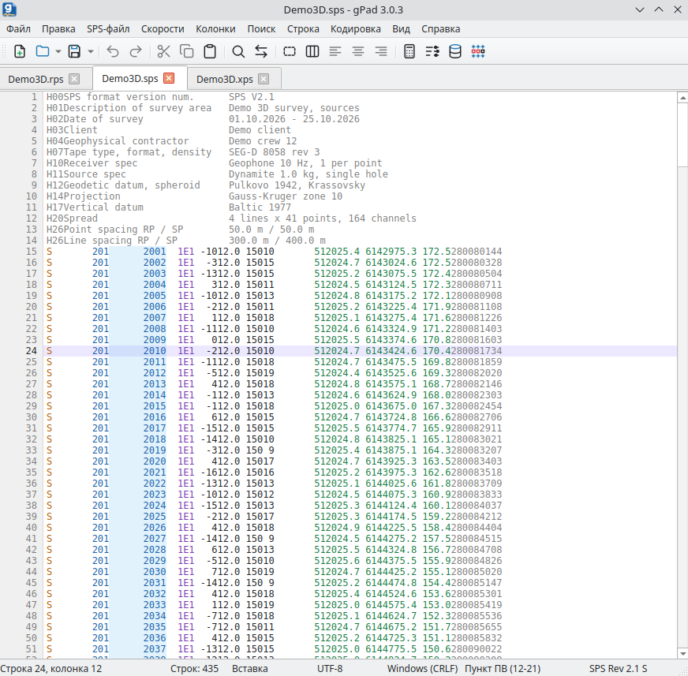

# gPad

**Текстовый редактор для геофизика**

gPad работает с любыми текстовыми файлами, но в первую очередь заточен под сейсморазведку:
геометрию наблюдений SPS (R, S и X), законы скоростей (VELF, LVI, Handvel, V5 и др.), 
статические поправки и координаты. Поля в таких файлах привязаны к фиксированным позициям, 
поэтому в редакторе есть блочное выделение и колоночный режим: любые операции и правки 
применяются сразу ко всей колонке, а не построчно.

Стандарт и тип записей SPS программа определяет сама, подсвечивает нужные поля и предлагает 
только подходящие операции. Пункты из всех открытых файлов отображаются на схеме с 
отстрелами и активной расстановкой, а координаты, отметки и статики можно накапливать
в базе ПВ и ПП, чтобы затем заполнять ими файлы SPS.



## Скачать

[:material-microsoft-windows: Windows](https://github.com/daniscoder/daniscoder.github.io/releases/download/gPad/gpad-setup.exe){ .md-button .md-button--primary }
[:material-linux: Linux](https://github.com/daniscoder/daniscoder.github.io/releases/download/gPad/gpad.tar.xz){ .md-button }

Текущая версия - 3.0.0. Для Windows - установщик: по умолчанию он ставит программу
только для вас, без прав администратора, с ярлыком в меню «Пуск» (на рабочем столе - по
желанию); для всех пользователей - выбором в первом окне. Программа сама проверяет
обновления и ставит новую версию по одной кнопке.

Для Linux - архив: распакуйте его и запустите `install.sh`, программа появится в меню
приложений и как команда `gpad`, права администратора не нужны. Удаление -
`uninstall.sh` в папке программы `~/.local/share/gpad`. Linux-версия рассчитана на
системы с glibc 2.38 и новее: Ubuntu 24.04 и новее, Debian 13, Fedora 39 и новее, RHEL,
Rocky и Alma 10 ([подробнее](index.md#run)). О новой версии она сообщает сама, но
ставится новая версия вручную, тем же архивом поверх прежней.

```bash
tar -xJf gpad.tar.xz
./gpad/install.sh
```

Чтобы попробовать редактор, можно скачать пример трехмерной съемки в SPS Rev 2.1 -
[Demo3D.rps](examples/gpad/Demo3D.rps), [Demo3D.sps](examples/gpad/Demo3D.sps) и
[Demo3D.xps](examples/gpad/Demo3D.xps), на нем сделан снимок экрана выше.

### Версия 2.0 для старых систем

Для старых систем на сайте остается прежняя версия 2.0: для Linux вроде CentOS 7, RHEL,
Rocky и Alma 8 и 9, Ubuntu 22.04, Debian 12, Astra Linux, где 3.0 не запускается, и для
Windows ниже 10. Установка не нужна: программа - один файл. Версия 2.0 больше не
развивается, и в ней нет того, что появилось в 3.0.

[:material-microsoft-windows: Windows (2.0)](https://github.com/daniscoder/daniscoder.github.io/releases/download/gPad/gPad.exe){ .md-button }
[:material-linux: Linux (2.0)](https://github.com/daniscoder/daniscoder.github.io/releases/download/gPad/gPad){ .md-button }

Linux-версии 2.0 нужна библиотека GTK2. На компьютере с рабочим столом она обычно уже
установлена, а если нет, ее можно поставить так:

```bash
sudo apt install libgtk2.0-0t64   # Ubuntu 24.04, Debian 13
sudo apt install libgtk2.0-0      # Ubuntu 22.04, Debian 12
sudo yum install gtk2             # CentOS, RHEL, Rocky, Alma
```

## Обычный текст

Для работы с обычным текстом редактор предоставляет стандартный набор возможностей:

- несколько файлов во вкладках, недавние файлы, добавление другого файла в конец
  страницы, разбиение крупного файла на части;
- файлы в миллионы строк открываются в фоне за секунды и правятся без задержек;
- кодировки UTF-8, UTF-16, Windows-1251, DOS-866, KOI8-R и Windows-1252 и концы строк
  Windows, Unix и Mac определяются при открытии, и файл сохраняется в них же;
- поиск и замена, в том числе по регулярным выражениям и в пределах выделенного
  фрагмента;
- закладки: десять номерных и свободные; можно удалить все строки с закладкой или,
  наоборот, без нее;
- полоса измененных строк у номеров: желтая - изменено и не сохранено, зеленая -
  сохранено;
- сортировка строк, в том числе по колонкам с любым числом уровней;
- удаление пустых строк, дубликатов и строк по маске, отбор каждой N-й строки, смена
  регистра;
- чистка текста: замена символов (например, десятичной запятой на точку), кириллица-двойники
  в латиницу в кодах пунктов, невидимые знаки, пробелы в конце строк, табуляция.

## Колонки

Блочное выделение и режим колонки дополняют стандартные возможности редактора при
работе с колоночными форматами. Блок выделяется мышью с Alt или клавишами Alt со
стрелками. Для колонки доступны следующие операции:

- набор текста с клавиатуры прямо в колонку: набранное, Backspace и Delete действуют
  сразу на все строки колонки ниже курсора, в той же позиции;
- вставка, удаление, вырезание и сдвиг колонки; выравнивание влево, вправо или по
  центру;
- вставка нумерации с заданными первым номером, шагом и ведущими нулями;
- арифметика колонки (прибавить, вычесть, умножить, разделить, записать значение) и
  сводка: количество значений, минимум, максимум, сумма и среднее;
- вставка колонки из буфера обмена, в том числе повтором до конца текста, и
  распределение текста с разделителями по ровным колонкам.

## SPS

Программа понимает SPS R, S и X стандартов Rev 0 и Rev 2.1. Вид записей и стандарт она
определяет по началу файла, а в меню «SPS-файл» предлагает только пункты, подходящие для
страницы. Для файлов SPS предусмотрены:

- подсветка полей по смыслу: ключ, индекс и код, координаты и отметка, дата и время;
  звездочки и не числа в числовых полях отмечаются как ошибки. Поле под курсором
  выделяется на всех записях, а его название и позиции видны в строке состояния;
- перевод между Rev 0 и Rev 2.1 и приведение записей к стандарту. Значение, которое не
  поместилось в поле, записывается звездочками, и программа сообщает об этом: молча
  ничего не обрезается;
- выделение, очистка и арифметика колонок SPS по названиям полей, выборка записей по
  значениям поля;
- сортировка, в том числе по полям SPS с любым числом уровней, поиск текущего ПВ в
  файлах S и X, удаление дубликатов пунктов;
- работа с шапкой и записями: убрать комментарий, вставить дополнительную информацию -
  индекс, код, юлианский день, время;
- проверка X: унифицировать номера записей, показать пропущенные, удалить перестрелы
  ПВ;
- построение SPS R и S по SPS X, а для 2D - по координатам точек излома профилей.
  «Связать с SPS X» выстраивает R или S в порядке пунктов X и отмечает недостающие;
- импорт таблицей из текста, буфера обмена и Excel (.xlsx и .xls) с определением колонок
  по заголовкам и данным; экспорт в текст, буфер обмена и Excel;
- выгрузка в библиотеку Geocluster: Libri ST и Libri XY.

## Схема ПВ и ПП

Схема показывает пункты всех открытых страниц R и S, сотни тысяч сразу и без задержек.
Отстрелы берутся из открытых страниц X: ПВ без отстрела, отстрелянные и с перестрелом
видны разным цветом.

Shift + щелчок по пункту показывает его активную расстановку: у ПВ - его ПП по всем
записям X, у ПП - ПВ, которые в него пишут. Запись пункта при этом выделяется в тексте,
а в окне «Пункт» видны ее поля, номера записей (FFID) и итог расстановки с удалениями.
Если открыто несколько площадей с одинаковыми номерами пунктов, расстановка берется
только по своей площади. Схему можно сохранить картинкой.

## База ПВ и ПП

База - отдельный файл с двумя таблицами, ПП и ПВ. В ней удобно копить координаты,
отметки, статические поправки, глубины и вертикальные времена скважин из разных
источников: файлов SPS, текста, буфера обмена и Excel. Таблицы правятся прямо в ячейках
с отменой правок. Если запись уже есть в базе, можно оставить прежнюю, заменить новой
или дописать только пустые поля.

Из базы обновляются страницы SPS: отмеченные поля берутся по ключу пункта, а пустые
значения базы ничего не затирают. Выгрузить базу можно в SPS, текст, буфер обмена и
Excel.

## Скорости

Встроенный конвертор переводит законы скоростей между 11 форматами: Omega VELF,
Geocluster LVI и V5, Handvel, Landmark, ProMAX, Hampson-Russell, Shell V5 / Charisma и
Charisma VL_B читаются и записываются, SeisBase III и Charisma VL_A только записываются.
Формат страницы определяется по содержимому. V5 можно собрать из двух страниц - Handvel
и Geoq.

## Справка и обновления

Подробная справка с оглавлением, поиском и картинками открывается клавишей F1; в любом
окне - сразу раздел про него. Интерфейс и справка - на русском и английском языках, язык
выбирается в меню «Вид» - «Язык».

При запуске, не чаще раза в сутки, программа проверяет, нет ли новой версии, и
показывает, что нового во всех пропущенных версиях. В Windows новая версия ставится
поверх прежней по одной кнопке, в Linux - архивом со страницы релиза; настройки и файлы
не трогаются.

## История версий

| Версия | Что нового |
|---|---|
| 3.0.0 | Программа переписана на C++ и Qt 6 и работает в Windows и Linux, в Windows ставится установщиком и сама проверяет обновления; свой редактор: файлы в миллионы строк открываются в фоне, блочное выделение, режим колонки, полоса измененных строк; подсветка полей SPS; схема ПВ и ПП с отстрелами и активной расстановкой; база ПВ и ПП с отменой правок, импорт из текста, буфера обмена и Excel; перевод скоростей между 11 форматами; справка по F1 и английский язык интерфейса |
| 2.0 | Переписана на Free Pascal в Lazarus: Windows и Linux, 64 бита |
| 1.5 | Версия на Delphi, только Windows, 32 бита |

Если в программе чего-то не хватает, напишите ([контакты](author.md#contacts)).
