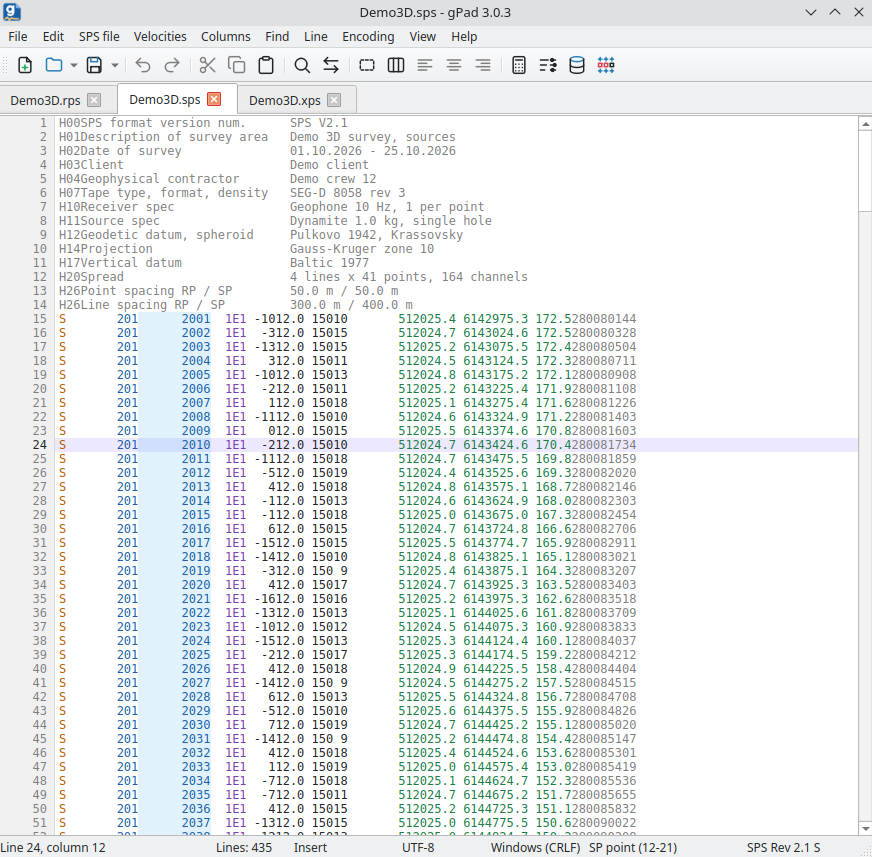

# gPad

**面向地球物理人员的文本编辑器**

gPad 可以处理任何文本文件，但首先是为地震勘探数据打造的：SPS 观测系统（R、S 和 X）、速度函数（VELF、
LVI、Handvel、V5 等）、静校正量和坐标。这类文件中的字段绑定在固定位置上，因此编辑器提供块选择和列模式：
任何操作和修改都会一次作用于整列，而不是逐行进行。

程序会自动识别 SPS 的版本和记录类型，高亮显示相应字段，并且只提供适用的操作。所有打开文件中的点显示在平面图上，
附带放炮情况和活动排列；坐标、高程和静校正量可以积累在炮点和检波点数据库中，之后再用来填写 SPS 文件。



## 下载

[:material-microsoft-windows: Windows](https://github.com/daniscoder/daniscoder.github.io/releases/download/gPad/gpad-setup.exe){ .md-button .md-button--primary }
[:material-linux: Linux](https://github.com/daniscoder/daniscoder.github.io/releases/download/gPad/gpad.tar.xz){ .md-button }

当前版本为 3.0.0。Windows 版使用安装程序：默认只为当前用户安装，不需要管理员权限，并在“开始”菜单中创建快捷方式
（桌面快捷方式可选）；为所有用户安装可在第一个窗口中选择。程序会自动检查更新，只需一个按钮即可安装新版本。

Linux 版是一个压缩包：解压后运行 `install.sh`，程序就会出现在应用程序菜单中，也可以用 `gpad` 命令启动，不需要管理员权限。
卸载 - 运行程序文件夹 `~/.local/share/gpad` 中的 `uninstall.sh`。Linux 版适用于 glibc 2.38 及更新版本的系统：
Ubuntu 24.04 及更新版本、Debian 13、Fedora 39 及更新版本、RHEL、Rocky 和 Alma 10（[详细说明](index.md#run)）。
它会自动提示新版本，但新版本需要手动安装：用同样的压缩包覆盖安装在旧版本之上。

```bash
tar -xJf gpad.tar.xz
./gpad/install.sh
```

要试用编辑器，可以下载 SPS Rev 2.1 格式的三维工区示例 - [Demo3D.rps](examples/gpad/Demo3D.rps)、
[Demo3D.sps](examples/gpad/Demo3D.sps) 和 [Demo3D.xps](examples/gpad/Demo3D.xps)；上面的截图就是用它制作的。

### 用于旧系统的 2.0 版

本站为旧系统保留以前的 2.0 版：用于无法运行 3.0 的 Linux，例如 CentOS 7、RHEL、Rocky 和 Alma 8 和 9、Ubuntu 22.04、
Debian 12、Astra Linux，以及 Windows 10 以前的 Windows。无需安装：程序就是一个文件。2.0 版已不再开发，
没有 3.0 中新增的功能，界面只有俄文。

[:material-microsoft-windows: Windows (2.0)](https://github.com/daniscoder/daniscoder.github.io/releases/download/gPad/gPad.exe){ .md-button }
[:material-linux: Linux (2.0)](https://github.com/daniscoder/daniscoder.github.io/releases/download/gPad/gPad){ .md-button }

2.0 的 Linux 版需要 GTK2 库。有桌面环境的计算机通常已经有了；如果没有，可以这样安装：

```bash
sudo apt install libgtk2.0-0t64   # Ubuntu 24.04, Debian 13
sudo apt install libgtk2.0-0      # Ubuntu 22.04, Debian 12
sudo yum install gtk2             # CentOS, RHEL, Rocky, Alma
```

## 普通文本

对于普通文本，编辑器提供标准的功能：

- 在选项卡中打开多个文件，最近文件，把另一个文件追加到页面末尾，把大文件拆分成几部分；
- 数百万行的文件在后台几秒钟内打开，编辑时没有延迟；
- 打开时自动识别 UTF-8、UTF-16、Windows-1251、DOS-866、KOI8-R 和 Windows-1252 编码以及 Windows、Unix 和
  Mac 换行符，保存时保持不变；
- 查找和替换，包括正则表达式和在选区内查找；
- 书签：十个编号书签和任意书签；可以删除所有带书签的行，或者反过来删除所有不带书签的行；
- 行号旁的修改标记条：黄色 - 已修改未保存，绿色 - 已保存；
- 行排序，包括按列的任意多级排序；
- 删除空行、重复行和按掩码删除行，保留每第 N 行，转换大小写；
- 文本清理：替换字符（例如把小数逗号换成点），把点代码中形似拉丁字母的西里尔字母换成拉丁字母，
  去除不可见字符、行尾空格和制表符。

## 列

在处理按列排列的格式时，块选择和列模式扩展了编辑器的标准功能。块可以按住 Alt 用鼠标选择，也可以用 Alt 加方向键选择。
对列可以进行以下操作：

- 直接在列中用键盘输入文本：输入的内容以及 Backspace 和 Delete 会同时作用于光标下方该列所有行的同一位置；
- 插入、删除、剪切和移动列；左对齐、右对齐或居中；
- 按给定的起始号、步长和前导零插入编号；
- 列算术运算（加、减、乘、除、写入数值）和汇总：数值个数、最小值、最大值、总和和平均值；
- 从剪贴板插入列，包括重复填充到文本末尾，以及把带分隔符的文本排成整齐的列。

## SPS

程序支持 Rev 0 和 Rev 2.1 版本的 SPS R、S 和 X。它根据文件开头识别记录类型和版本，“SPS file”菜单中只提供适用于当前页面的项目。
SPS 文件有以下功能：

- 按含义高亮显示字段：键、索引和代码、坐标和高程、日期和时间；数值字段中的星号和非数字标记为错误。
  光标所在字段在所有记录中高亮显示，其名称和位置显示在状态栏中；
- Rev 0 和 Rev 2.1 之间的转换以及按标准整理记录。放不进字段的值写成星号，程序会给出提示：不会悄悄截断任何内容；
- 按字段名称选择、清除 SPS 列并进行算术运算，按字段值筛选记录；
- 排序，包括按 SPS 字段的任意多级排序，在 S 和 X 文件中查找当前炮点，删除重复的点；
- 处理文件头和记录：删除注释，插入附加信息 - 索引、代码、儒略日、时间；
- 检查 X：统一记录号，显示缺失的编号，删除炮点的重复放炮；
- 根据 SPS X 生成 SPS R 和 S，对于二维 - 根据测线拐点坐标生成。“Tie to SPS X”（与 SPS X 关联）按 X 中点的顺序排列 R 或 S，
  并标出缺失的点；
- 从文本、剪贴板和 Excel（.xlsx 和 .xls）按表格导入，按表头和数据自动识别列；导出到文本、剪贴板和 Excel；
- 导出为 Geocluster 库：Libri ST 和 Libri XY。

## 炮点和检波点平面图

平面图显示所有打开的 R 和 S 页面中的点，数十万个点一次显示，没有延迟。放炮情况取自打开的 X 页面：未放炮、
已放炮和重复放炮的炮点用不同颜色显示。

Shift + 单击点会显示它的活动排列：炮点 - 它在所有 X 记录中的检波点，检波点 - 向它记录的炮点。同时该点的记录在文本中被选中，
“Point”（点）窗口显示记录的字段、记录号（FFID）以及带偏移距的排列汇总。如果打开了几个点号相同的工区，
排列只取该点自己的工区。平面图可以保存为图片。

## 炮点和检波点数据库

数据库是一个单独的文件，包含两张表：检波点和炮点。它便于从不同来源积累坐标、高程、静校正量、井深和井口时间：
SPS 文件、文本、剪贴板和 Excel。表格直接在单元格中编辑，可以撤销。如果数据库中已有该记录，可以保留原有记录、
用新记录替换，或者只填写空字段。

可以用数据库更新 SPS 页面：勾选的字段按点的键取值，数据库中的空值不会覆盖任何内容。数据库可以导出到 SPS、文本、
剪贴板和 Excel。

## 速度

内置的转换器可以在 11 种格式之间转换速度函数：Omega VELF、Geocluster LVI 和 V5、Handvel、Landmark、ProMAX、
Hampson-Russell、Shell V5 / Charisma 和 Charisma VL_B 可以读写，SeisBase III 和 Charisma VL_A 只能写入。
页面格式根据内容自动识别。V5 可以由两个页面 - Handvel 和 Geoq 合成。

## 帮助和更新

带目录、搜索和图片的详细帮助按 F1 打开；在任何窗口中都会直接打开关于该窗口的章节。界面和帮助有英文和俄文，
语言在“View” - “Language”（视图 - 语言）中选择，暂时没有中文。本页截图是英文界面。

程序在启动时检查是否有新版本（每天最多一次），并显示所有跳过的版本中的新内容。在 Windows 上新版本只需一个按钮即可覆盖安装在旧版本之上，
在 Linux 上用发布页面的压缩包安装；设置和文件保持不变。

## 版本历史

| 版本 | 新内容 |
|---|---|
| 3.0.0 | 用 C++ 和 Qt 6 重写，可在 Windows 和 Linux 上运行，Windows 版使用安装程序并自动检查更新；自己的编辑器：数百万行的文件在后台打开，块选择、列模式、修改标记条；SPS 字段高亮；带放炮情况和活动排列的炮点和检波点平面图；可撤销编辑的炮点和检波点数据库，从文本、剪贴板和 Excel 导入；11 种速度格式之间的转换；F1 帮助和英文界面 |
| 2.0 | 用 Free Pascal 和 Lazarus 重写：Windows 和 Linux，64 位 |
| 1.5 | Delphi 版本，仅限 Windows，32 位 |

如果程序中缺少什么功能，请告诉我（[联系方式](author.md#contacts)）。
