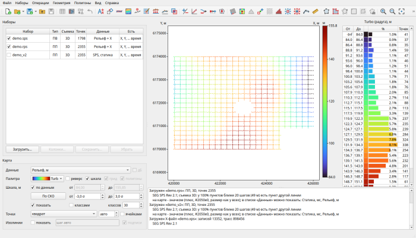

# seisboard

**Seismic data on a single board**

seisboard brings together source and receiver static corrections, SPS acquisition
geometry, the survey grid and fold, and quality attributes: one map, tables, operations,
and output to Omega, SPS, Excel and Surfer formats.

The program and its help are in Russian for now, so its page is available
[in Russian](/seisboard/) only. A free 30-day demo can be downloaded there; the full
version works with a key from the author.

