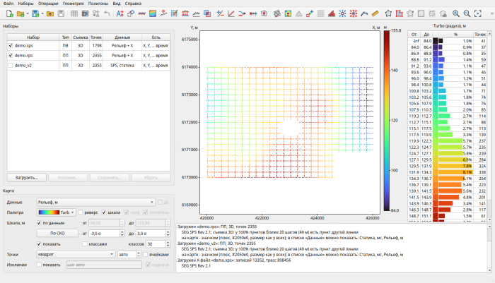

# seisboard

**Seismic data on a single board**

seisboard brings work with 2D/3D geometry, static corrections, maps and quality
attributes together in a single window, replacing the combination of Mesa, Surfer and
MAD (Omega). In the program you can design a future survey or lay out sources and
receivers for 5D regularization, load existing geometry from SPS, compute the grid, fold
and offset classes, build and smooth maps, decompose and stitch static solutions, fix
outliers with a brush right on the map and compare variants with each other.

The program directly reads column exports of popular processing systems and any text
tables, SPS files (R, S and X, Rev 0 and Rev 2.1) and Excel and LibreOffice workbooks.
Columns are recognized by their headers automatically, and any numeric column at once
becomes a value that can be shown on the map, gridded into a surface or used in
calculations. The result is saved back to SPS, a dump, Excel tables or a Surfer grid.

The program and its help are in Russian for now, so its page is available
[in Russian](/seisboard/) only. A free 30-day demo can be downloaded there; the full
version works with a key from the author.

