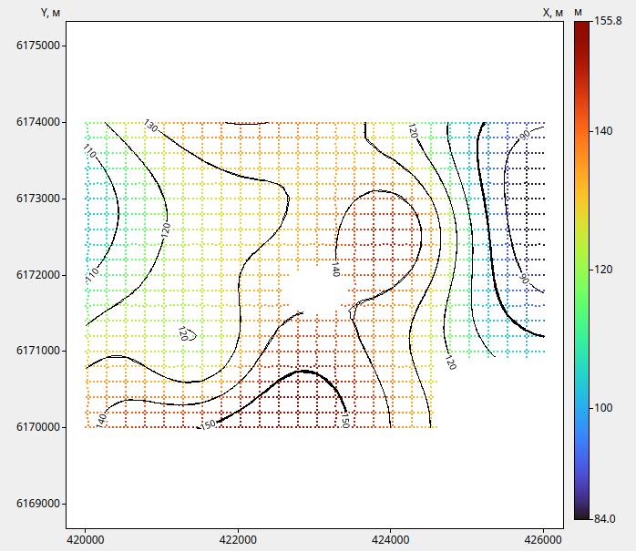
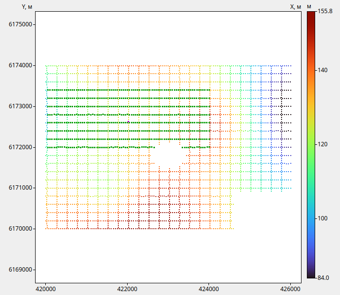
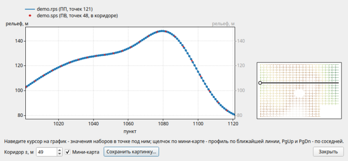
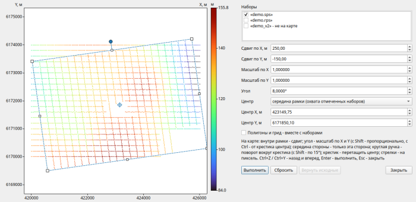
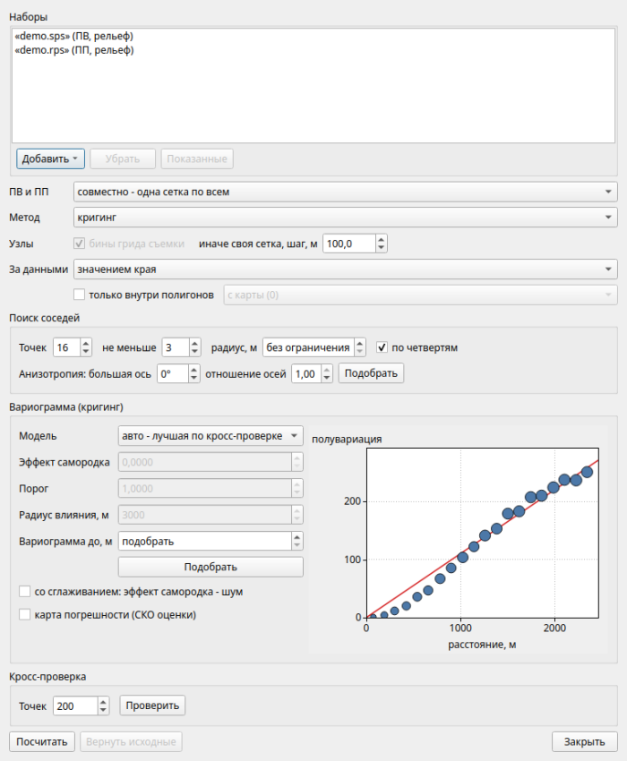
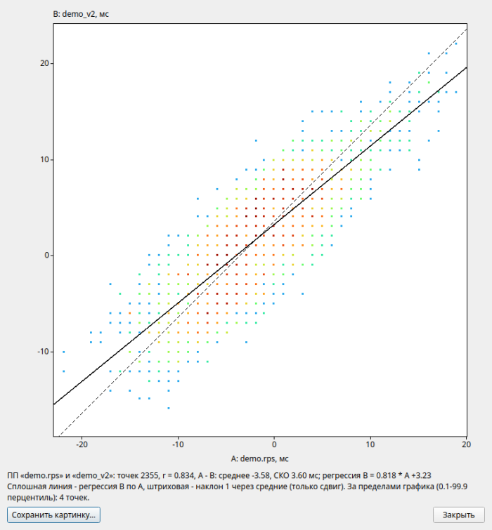
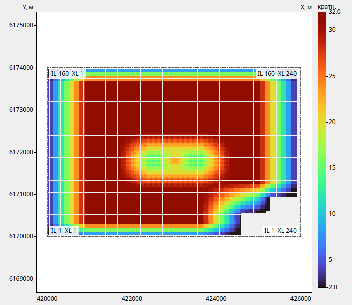
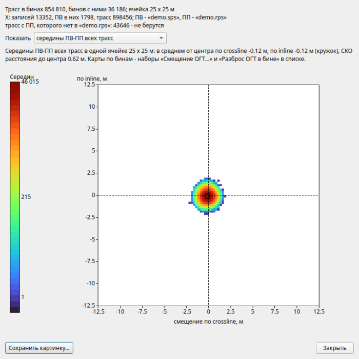
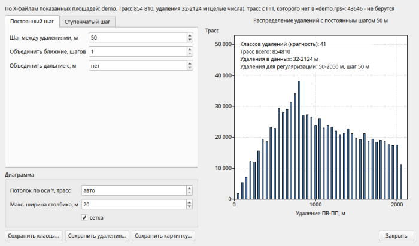

# seisboard

**Данные сейсморазведки на одной доске**

seisboard собирает в одном окне то, с чем обработчик работает до обработки и на ее
первых шагах: статические поправки ПВ и ПП, геометрию по SPS, грид съемки и кратность,
атрибуты качества. Данные загружаются наборами, показываются на общей карте и в
таблицах, обрабатываются операциями и записываются обратно в форматы Омеги, SPS, в
дамп, Excel или в сетку Surfer.

Программа читает колоночные выгрузки популярных систем обработки сейсмических данных и
любые таблицы в колонках, файлы SPS (R, S и X стандартов Rev 0 и Rev 2.1), таблицы
Excel и LibreOffice. Колонки распознаются по заголовкам, а любая числовая колонка
становится величиной, которую можно показать на карте.

## Скачать

**Демо-версия** - бесплатно, без ключа, 30 дней. В ней работает все, кроме вывода
результатов наружу (записи файлов, сессий, полигонов и картинок, копирования), а на
карте стоит водяной знак.

[:material-microsoft-windows: Windows](https://github.com/daniscoder/daniscoder.github.io/releases/download/seisboard/seisboard-demo-setup.exe){ .md-button .md-button--primary }
[:material-linux: Linux](https://github.com/daniscoder/daniscoder.github.io/releases/download/seisboard/seisboard-demo.tar.xz){ .md-button }
[:material-linux: Linux (старые системы)](https://github.com/daniscoder/daniscoder.github.io/releases/download/seisboard/seisboard-demo-legacy.tar.xz){ .md-button }

**Полная версия** работает по ключу, выданному на компьютер. При первом запуске
программа показывает код компьютера: отправьте его автору на
[почту](mailto:arslanovdk@gmail.com) или в [Telegram](https://t.me/ar_dans), и вы
получите ключ.

[:material-microsoft-windows: Windows](https://github.com/daniscoder/daniscoder.github.io/releases/download/seisboard/seisboard-setup.exe){ .md-button .md-button--primary }
[:material-linux: Linux](https://github.com/daniscoder/daniscoder.github.io/releases/download/seisboard/seisboard.tar.xz){ .md-button }
[:material-linux: Linux (старые системы)](https://github.com/daniscoder/daniscoder.github.io/releases/download/seisboard/seisboard-legacy.tar.xz){ .md-button }

Полная версия и демо - разные программы: они ставятся рядом и не мешают друг другу.

Для Windows - установщик: по умолчанию он ставит программу только для вас, без прав
администратора, с ярлыком в меню «Пуск» (на рабочем столе - по желанию); для всех
пользователей - выбором в первом окне. Для Linux - архив: распакуйте его и запустите
`install.sh`, программа появится в меню приложений и как команда `seisboard`
([подробнее](index.md#run)).

Linux-версия рассчитана на системы с glibc 2.38 и новее: Ubuntu 24.04 и новее,
Debian 13, Fedora 39 и новее, RHEL, Rocky и Alma 10. Для более старых систем -
CentOS 7, RHEL, Rocky и Alma 8 и 9, Ubuntu 22.04, Debian 12, Astra Linux - есть сборка
«Linux (старые системы)»: она собрана на Qt5 и запускается на любой системе с glibc
2.17 и новее ([подробнее](index.md#run)).

Текущая версия - 1.0.14. Программа сама проверяет обновления и ставит новую версию по
одной кнопке. Интерфейс и справка пока только на русском языке.

## Карта

На общей карте показываются ПВ, ПП и бины разных наборов, 2D и 3D, с координатами или
без них. В списке «Данные» выбирается, что показывать: статику, рельеф, кратность,
атрибут, день и порядок отстрела, FFID или только расположение пунктов. Шкала - по
данным, вручную или по СКО, раскраска плавная или классами с таблицей классов. Поверх
точек - изолинии с подписями.

Shift + щелчок по пункту выделяет его и показывает активную расстановку: у ПВ - его
ПП, у ПП - ПВ, которые в него пишут. Рядом открывается окно с данными пункта, которые
можно поправить. По правой кнопке на пункте - профили по линии ПП и ПВ, по Inline и
Crossline; есть и произвольный профиль по ломаной.

Варианты удобно сравнивать на одном виде: Flip переключает наборы по кругу, Roll
показывает два набора шторкой.

## Операции

Операции берут наборы, показанные на карте, и дают новые наборы, не меняя исходных:

- формула и константа: `A + 5`, `A*2`, функции, тригонометрия;
- трансформация координат рамкой прямо на карте и числами: сдвиг, масштаб, поворот;
- сглаживание и разделение статики на коротко-, средне- и длиннопериодную
  составляющие;
- гридирование: кригинг с подбором вариограммы, радиальные базисные функции, обратные
  расстояния, триангуляция; кросс-проверка методов;
- поиск вылетов по медиане соседей;
- правка значений кистью прямо на карте;
- статика за рельеф и плавающий уровень с сеткой для Омеги;
- объединение наборов, в том числе статики по блокам ОГТ.

Над двумя наборами - калькулятор по ключу точки, сравнение решений с картой локальной
корреляции и кроссплотом, сборка «длинно из одного решения, коротко из другого»,
перенос значений по координатам и выравнивание одного решения к другому по участкам.

## Геометрия

С X-файлом SPS программа считает кратность на гриде съемки и показывает графики:
бины по кратности, трассы по удалениям и азимутам, розу. Грид задается как в Омеге,
загружается из ее описания или рассчитывается по пунктам и по средним точкам. Облако
ОГТ показывает, насколько середины ПВ-ПП смещены от центров бинов.

Классы удалений для регуляризации 3D считаются прямо по SPS: с постоянным или
ступенчатым шагом.

Полигон границы площади строится по данным, рисуется и правится на карте; по
полигонам наборы обрезаются, а в таблице статистики считаются площадь, пункты и
кратность внутри каждого.

## Сессия и справка

Вся работа - наборы, полигоны, грид, вид карты, итоги расчетов - сохраняется одним
файлом сессии. Работать можно в метрах или в футах. Подробная справка с оглавлением,
поиском и картинками открывается клавишей F1; в любом окне - сразу раздел про него.
Карты, графики, таблицы и справку можно напечатать.

## История версий

| Версия | Что нового |
|---|---|
| 1.0.14 | Рамка зума правой кнопкой; значки ПВ и ПП не зависят от того, какие наборы показаны; точки грида в буфер; обновления проверяются и во время работы |
| 1.0.13 | Классы удалений пересчитываются сами, подбор зон - в фоне |
| 1.0.12 | Загрузка по одним X и Y; выделение пункта и окно с его данными; окна правки и трансформации не закрывают карту; полигоны можно спрятать |
| 1.0.11 | Трансформация координат рамкой прямо на карте |
| 1.0.10 | Новая сессия; грид - часть сессии |
| 1.0.9 | Полигоны из файла; что нового во всех пропущенных версиях |
| 1.0.8 | Плавный сдвиг карты, правка кистью без перерисовки всей карты |
| 1.0.7 | Объединение наборов с правилами для общих точек (статика по блокам ОГТ) |
| 1.0.6 | Таблицы xls, xlsx, ods; запись в xlsx; функции формулы |
| 1.0.5 | Обновление из программы; правка значений кистью; статистика по полигонам |
