# seisboard

**Данные сейсморазведки на одной доске**

seisboard собирает в одном окне работу с геометрией 2D/3D, статическими поправками,
картами и атрибутами качества, заменяя связку из Mesa, Surfer и MAD (Omega). В
программе можно спроектировать будущую съемку или расположить ПВ и ПП для
5D-регуляризации, загрузить готовую геометрию по SPS, рассчитать грид, кратность и
классы удалений, построить и сгладить карты, разложить и сшить решения статики,
поправить вылеты кистью прямо на карте и сравнить варианты между собой.

Программа напрямую читает колоночные выгрузки популярных систем обработки и любые
текстовые таблицы, файлы SPS (R, S и X стандартов Rev 0 и Rev 2.1), книги Excel и
LibreOffice. Колонки автоматически распознаются по заголовкам, а любой числовой столбец
сразу становится величиной, которую можно отобразить на карте, построить по ней
поверхность или пустить в расчеты. Готовый результат сохраняется обратно в SPS, в
дамп, в таблицы Excel или в сетку Surfer.

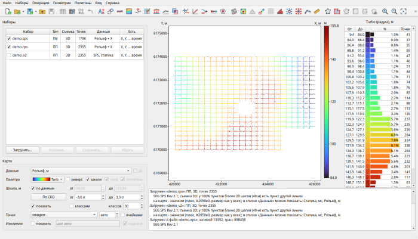

## Скачать

**Демо-версия** - бесплатно, без ключа, 30 дней. В ней работает все, кроме вывода
результатов наружу (записи файлов, сессий, полигонов и картинок, копирования), а на
карте стоит водяной знак.

[:material-microsoft-windows: Windows](https://github.com/daniscoder/daniscoder.github.io/releases/download/seisboard/seisboard-demo-setup.exe){ .md-button .md-button--primary }
[:material-linux: Linux](https://github.com/daniscoder/daniscoder.github.io/releases/download/seisboard/seisboard-demo.tar.xz){ .md-button }
[:material-linux: Linux (старые системы)](https://github.com/daniscoder/daniscoder.github.io/releases/download/seisboard/seisboard-demo-legacy.tar.xz){ .md-button }

**Полная версия** работает по ключу, выданному на компьютер. При первом запуске
программа показывает код компьютера: отправьте его автору на
[почту](mailto:arslanovdk@gmail.com) или в [Telegram](https://t.me/ar_dans), и вы
получите ключ.

[:material-microsoft-windows: Windows](https://github.com/daniscoder/daniscoder.github.io/releases/download/seisboard/seisboard-setup.exe){ .md-button .md-button--primary }
[:material-linux: Linux](https://github.com/daniscoder/daniscoder.github.io/releases/download/seisboard/seisboard.tar.xz){ .md-button }
[:material-linux: Linux (старые системы)](https://github.com/daniscoder/daniscoder.github.io/releases/download/seisboard/seisboard-legacy.tar.xz){ .md-button }

Полная версия и демо - разные программы: они ставятся рядом и не мешают друг другу.

Для Windows - установщик: по умолчанию он ставит программу только для вас, без прав
администратора, с ярлыком в меню «Пуск» (на рабочем столе - по желанию); для всех
пользователей - выбором в первом окне. Для Linux - архив: распакуйте его и запустите
`install.sh`, программа появится в меню приложений и как команда `seisboard`
([подробнее](index.md#run)).

Linux-версия рассчитана на системы с glibc 2.38 и новее: Ubuntu 24.04 и новее,
Debian 13, Fedora 39 и новее, RHEL, Rocky и Alma 10. Для более старых систем -
CentOS 7, RHEL, Rocky и Alma 8 и 9, Ubuntu 22.04, Debian 12, Astra Linux - есть сборка
«Linux (старые системы)»: она собрана на Qt5 и запускается на любой системе с glibc
2.17 и новее ([подробнее](index.md#run)).

Текущая версия - 1.0.18. Программа сама проверяет обновления и ставит новую версию по
одной кнопке. Интерфейс и справка пока только на русском языке.

## Карта

На общей карте отображаются ПВ, ПП и бины разных наборов данных (2D и 3D, с
координатами или без них). В списке «Данные» выбирается величина для отображения:
статика, рельеф, кратность, атрибут, день и порядок отстрела, FFID или просто схема
расположения пунктов. Шкала настраивается по данным, вручную или по СКО; раскраска может
быть плавной или по классам со своей таблицей. Поверх точек строятся изолинии с
подписями.

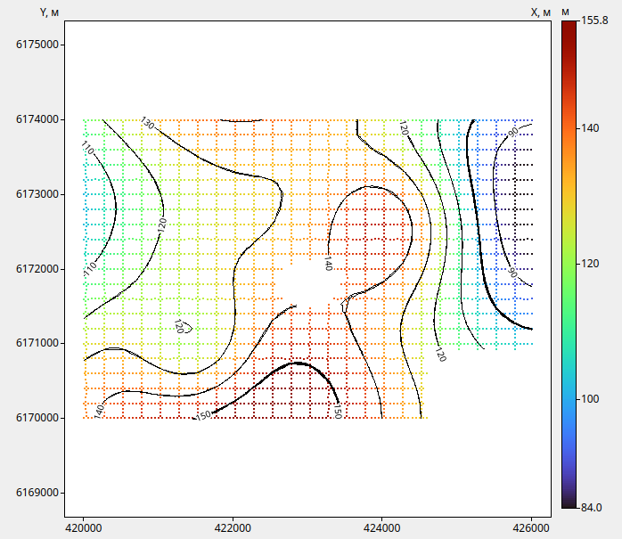

Shift + щелчок по пункту выделяет его и подсвечивает активную расстановку: для ПВ
показываются его ПП, а для ПП - все ПВ, которые в него пишут. Рядом открывается окно
со значениями пункта, где их можно сразу поправить. По правому клику на пункте
строятся профили вдоль линий ПП и ПВ, по Inline и Crossline, а также произвольный
профиль по ломаной линии.

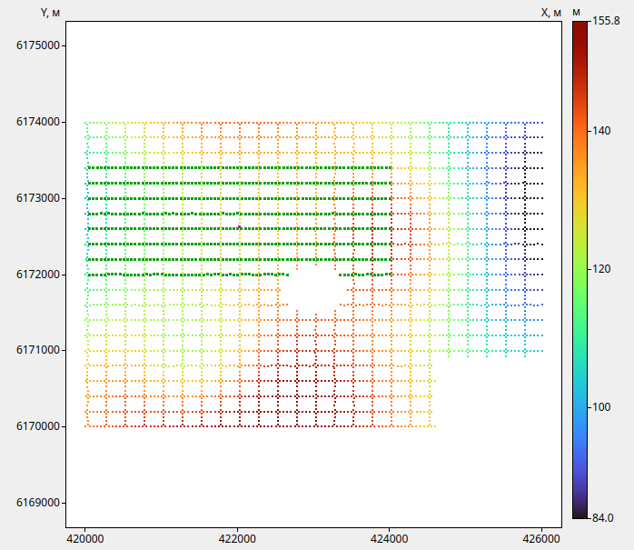

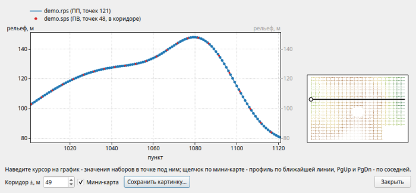

Разные варианты удобно сравнивать на одном экране: режим Flip переключает наборы по
кругу, а Roll позволяет сравнивать два набора с помощью подвижной шторки.

## Операции

Все операции работают с наборами на карте и создают на их основе новые, не меняя
исходные данные:

- расчеты по формулам и с константами: `A + 5`, `A*2`, математические функции,
  тригонометрия;
- трансформация координат рамкой прямо на карте или точными значениями: сдвиг,
  масштаб, поворот;
- сглаживание и разделение статики на коротко-, средне- и длиннопериодную
  составляющие;
- гридирование: кригинг с подбором вариограммы, радиальные базисные функции, метод
  обратных расстояний, триангуляция, а также кросс-проверка методов;
- поиск вылетов по медиане соседних точек;
- ручная правка значений кистью прямо на карте;
- расчет статики за рельеф и плавающего уровня приведения с выгрузкой сетки для Омеги;
- объединение наборов, в том числе сшивка статики по блокам ОГТ.

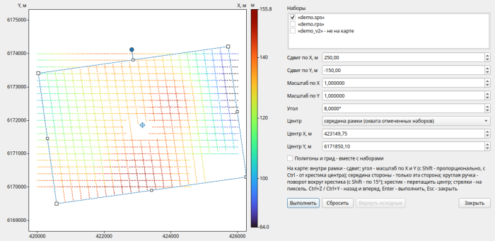

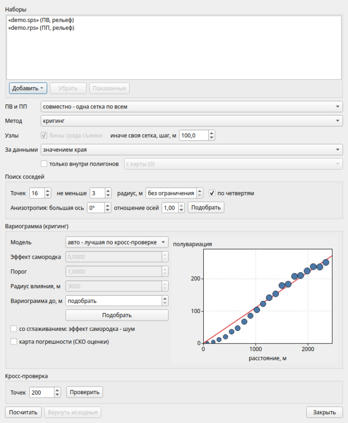

Для работы с двумя наборами есть калькулятор по ключу точки, сравнение решений с
построением карты локальной корреляции и кроссплота, комбинирование составляющих
(например, длиннопериодная статика из одного решения и короткопериодная из другого),
перенос значений по координатам и увязка одного решения с другим по участкам.

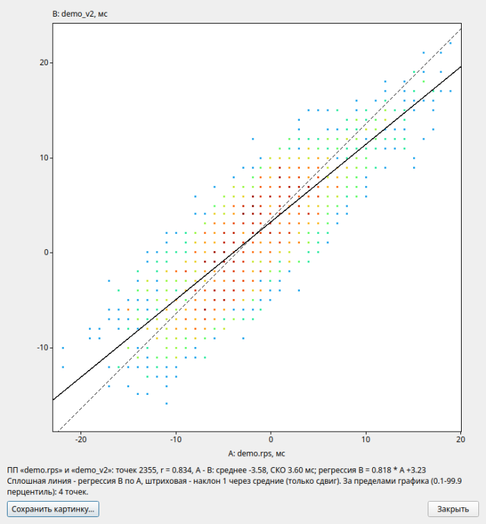

## Геометрия

При наличии X-файла SPS программа рассчитывает кратность на гриде съемки и строит
графики распределения: бины по кратности, трассы по удалениям и азимутам, а также
розу-диаграмму. Грид можно задать как в Омеге, загрузить из ее описания либо рассчитать
автоматически по пунктам или средним точкам. Облако ОГТ наглядно показывает разброс и
смещение средних точек ПВ-ПП относительно центров бинов.

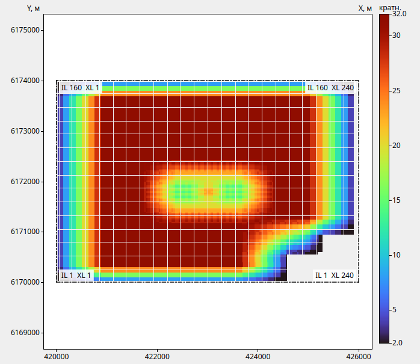

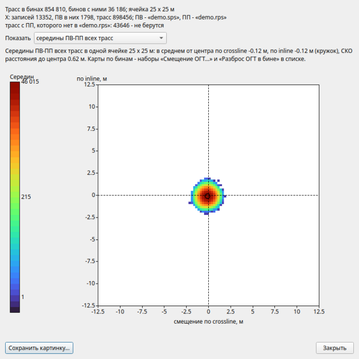

В программе можно с нуля спроектировать будущую съемку. Дизайнер ПВ и ПП строит пункты
по заданным параметрам линий (интервалам, первому пункту, азимуту, нумерации), по гриду
съемки и внутри контуров. Модуль отстрела формирует для них X-файл по шаблону: по числу
линий и каналов, прямоугольным окном или по диапазону удалений. Сразу после этого можно
рассчитать кратность и облако ОГТ - точно так же, как по реальному X-файлу. Для
5D-регуляризации дизайнер готовит таргеты: ПВ и ПП на проектных местах, без смещений,
как если бы их не было.

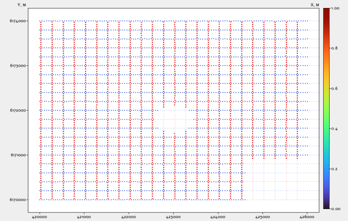

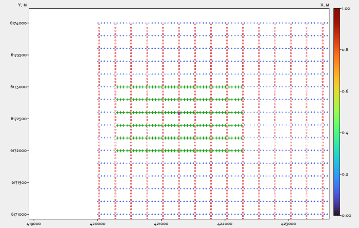

Классы удалений для 3D-регуляризации рассчитываются напрямую по SPS с постоянным или
переменным шагом.

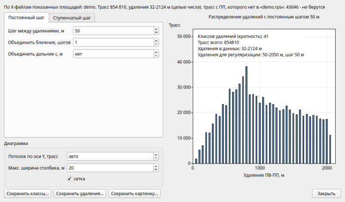

Полигон границы площади строится автоматически по данным либо рисуется и правится
вручную на карте. По полигонам можно обрезать наборы данных, а в таблице статистики для
каждого контура рассчитываются площадь, количество пунктов и кратность.

## Сессия и справка

Вся работа - наборы, полигоны, грид, вид карты, итоги расчетов - сохраняется одним
файлом сессии. Работать можно в метрах или в футах. Подробная справка с оглавлением,
поиском и картинками открывается клавишей F1; в любом окне - сразу раздел про него.
Карты, графики, таблицы и справку можно напечатать.

## История версий

| Версия | Что нового |
|---|---|
| 1.0.18 | Разбор номера пункта слитого дампа на индекс, линию и пункт - при загрузке и в таблице набора; загрузка с выбором колонок; X-файлы можно забывать по одному |
| 1.0.17 | Дизайнер ПВ и ПП: пункты съемки по параметрам линий, по гриду и полигонам; отстрел расстановки по шаблону (линии и каналы, прямоугольник, удаления); обмен грида с Омегой через буфер |
| 1.0.16 | Окно грида съемки рядом с картой: черновик сразу на карте, «Применить», правка рамкой мышью (сдвиг, ячейки, азимут); угол грида можно задать вручную; «Убрать запас» |
| 1.0.15 | Справка с оглавлением и поиском, F1 в любом окне; печать карты, графиков и таблиц, в том числе в PDF; одно окно ожидания при открытии сессии |
| 1.0.14 | Рамка зума правой кнопкой; значки ПВ и ПП не зависят от того, какие наборы показаны; точки грида в буфер; обновления проверяются и во время работы |
| 1.0.13 | Классы удалений пересчитываются сами, подбор зон - в фоне |
| 1.0.12 | Загрузка по одним X и Y; выделение пункта и окно с его данными; окна правки и трансформации не закрывают карту; полигоны можно спрятать |
| 1.0.11 | Трансформация координат рамкой прямо на карте |
| 1.0.10 | Новая сессия; грид - часть сессии |
| 1.0.9 | Полигоны из файла; что нового во всех пропущенных версиях |
| 1.0.8 | Плавный сдвиг карты, правка кистью без перерисовки всей карты |
| 1.0.7 | Объединение наборов с правилами для общих точек (статика по блокам ОГТ) |
| 1.0.6 | Таблицы xls, xlsx, ods; запись в xlsx; функции формулы |
| 1.0.5 | Обновление из программы; правка значений кистью; статистика по полигонам |
