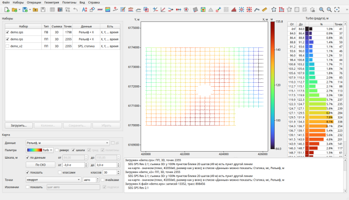

# seisboard

**地震勘探数据一览板**

seisboard 在一个窗口中集中完成 2D/3D 观测系统、静校正、平面图和质量属性的工作，可以替代
Mesa、Surfer 和 MAD（Omega）的组合。在程序中可以设计未来的观测系统，或为 5D 规则化布置炮点和
检波点；加载 SPS 中已有的观测系统，计算测网、覆盖次数和偏移距分组，绘制并平滑平面图，分解和
拼接静校正解，直接在地图上用画笔修正异常值，并对不同方案进行比较。

程序可直接读取常用处理系统的列格式导出文件和任意文本表格、SPS 文件（R、S 和 X，Rev 0 和
Rev 2.1 标准）以及 Excel 和 LibreOffice 工作簿。列按表头自动识别，任何数值列都会立即成为可以
显示在地图上、网格化为曲面或参与计算的数据。结果可保存回 SPS、转储文件、Excel 表格或 Surfer
网格。

目前程序及其帮助仅有俄文版，因此本页面只提供[俄文版](/seisboard/)。在那里可以下载免费的
30 天试用版；完整版需要向作者索取许可密钥。

